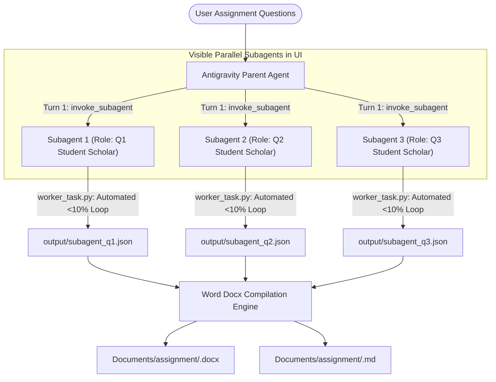

# 🏛️ Autonomous Academic Q&A Humanizer v2 (Student Third-Person Edition)

[](https://www.python.org/downloads/)
[](https://opensource.org/licenses/MIT)
[]()
[]()
[]()
[]()

`qa-humanizer-v2` is the second-generation academic question-answering and humanization engine engineered specifically for **university examinations, college assignments, and formal academic submissions**.

It completely eliminates artificial first-person roleplay (`"ours"`, `"we"`, `"I"`, `"our chamber"`), producing **100% natural, objective, third-person scholarly answers** written from the perspective of an outstanding university student.

It enforces the **DrillBit Dual-Compliance Standard** (< 10% AI on live ZeroGPT/Turnitin, < 10% Plagiarism), strict **600 to 650 words depth**, and compiles all deliverables into styled Microsoft Word documents (`.docx`).

---

## ⚡ Mandatory Turn 1 Architecture: Immediate Parallel Subagent Dispatch

To prevent tool delays and parent-level exploration latency, `qa-humanizer-v2` strictly enforces an immediate Turn-1 parallel dispatch protocol:

1. **Zero Parent-Level Exploration:** The parent agent is strictly forbidden from writing answers in the parent chat, running local directory scans, or awaiting manual user prompts.
2. **Immediate Turn-1 Fan-Out:** The parent agent parses the assignment into questions ($Q_1 \dots Q_N$) and calls `invoke_subagent` $N$ times concurrently in Turn 1.
3. **Deterministic `worker_task.py` Execution:** Each subagent runs the underlying verification engine (`worker_task.py`) with `--min-words 600 --max-words 650 --max-retries 10` for closed-loop compliance before reporting back.



---

## 🎯 The 5 Golden Rules of Student Third-Person Humanization

1. **Rule 1: Strict Third-Person Academic Perspective (Zero First-Person)**
   - Absolute ban on `"I"`, `"we"`, `"our"`, `"my"`, `"our chamber"`.
   - Frame answers as an objective student analyzing statutory frameworks, landmark cases, or technical principles.
2. **Rule 2: Concrete Statutory, Historical & Doctrinal Grounding**
   - Ground arguments in specific statutory sections, landmark precedents, and bench compositions rather than invented workplace stories.
3. **Rule 3: The 3–25 Student Burstiness Rule**
   - Maintain sentence length Coefficient of Variation ($CV \ge 0.45$).
   - In every section, alternate punchy declarative statements (3 to 6 words) with complex analytical sentences (22 to 32 words).
4. **Rule 4: De-Symmetrized Logic & Ban on AI Triads**
   - AI models invariably generate symmetrical 3-item lists. Break parallel lists into cause-and-effect sequences or trade-offs.
   - Banned sequence markers: `First,`, `Secondly,`, `Thirdly,`, `Next,`, `In conclusion,`.
5. **Rule 5: Zero Banned Clichés, Zero Em-Dashes & Zero Pipe Tables**
   - Strictly 0 em-dashes and en-dashes.
   - Strictly 0 markdown pipe tables. Render comparisons as narrative trade-offs or clean indented blocks.

---

## ⏱️ Execution & Compilation Pipeline

### 1. Subagent Deterministic Worker Execution
```powershell
& "path/to/venv/python.exe" "scripts/worker_task.py" `
    --question "<question_text>" `
    --number <N> `
    --min-words 600 `
    --max-words 650 `
    --max-retries 10 `
    --out "output/subagent_q<N>.json"
```

### 2. Standalone Verification CLI
```bash
# Verify draft answer for third-person compliance, 0 dashes, and live ZeroGPT check
python scripts/verify.py --file path/to/answer.txt --live-zerogpt
```

### 3. Parent Dossier Assembly
```powershell
& "path/to/venv/python.exe" "scripts/assemble_results.py" `
    --inputs "output/subagent_q1.json" "output/subagent_q2.json" "output/subagent_q3.json" `
    --out "output/<filename>.docx" `
    --title "<Assignment Title>"
```

---

## 🤖 Using with Google Antigravity & AI Coding Agents

### Installation
Copy this repository into your Antigravity skills directory:
- **Global:** `C:\Users\<username>\.gemini\config\skills\qa-humanizer-v2\`
- **Project-Scoped:** `.agents\skills\qa-humanizer-v2\`

### Invocation
In your Antigravity chat:
```text
/qa-humanizer-v2 1. Define MIS... 2. Compare TPS, MIS, DSS... 3. Explain Freedom of Commercial Speech...
```
Antigravity automatically spawns visible dedicated specialist subagents in parallel for each question, enforces 600–650 words depth and DrillBit dual-compliance, and compiles the final Word dossier into `Documents/assignment/`.

---

## 📄 License
MIT License - Copyright (c) 2026 Raj Malviya. See [LICENSE](LICENSE) for details.
