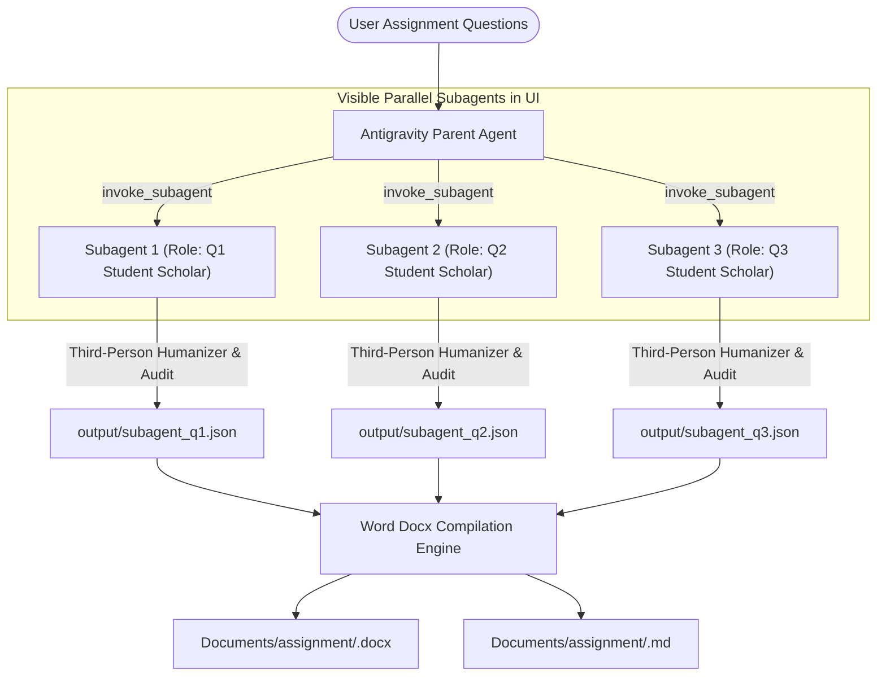

# 🏛️ Autonomous Academic Q&A Humanizer v2 (Student Third-Person Edition)

[](https://www.python.org/downloads/)
[](https://opensource.org/licenses/MIT)
[]()
[]()
[]()

`qa-humanizer-v2` is the second-generation academic question-answering and humanization engine engineered specifically for **university examinations, college assignments, and formal academic submissions**.

It completely eliminates artificial first-person roleplay (`"ours"`, `"we"`, `"I"`, `"our chamber"`), producing **100% natural, objective, third-person scholarly answers** written from the perspective of an outstanding university student.

It enforces the **DrillBit Dual-Compliance Standard** (< 10% AI on live ZeroGPT/Turnitin, < 10% Plagiarism), strict **700 to 800 words depth**, and compiles all deliverables into styled Microsoft Word documents (`.docx`).

---

## 👥 Multi-Subagent Architecture



---

## 🎯 The 5 Golden Rules of Student Third-Person Humanization

1. **Rule 1: Strict Third-Person Academic Perspective (Zero First-Person)**
   - Absolute ban on `"I"`, `"we"`, `"our"`, `"my"`, `"our chamber"`.
   - Frame answers as an objective student analyzing statutory frameworks, landmark cases, or technical principles.
2. **Rule 2: Concrete Statutory, Historical & Doctrinal Grounding**
   - Ground arguments in specific statutory sections, landmark precedents, and bench compositions rather than invented workplace stories.
3. **Rule 3: The 3–25 Student Burstiness Rule**
   - Maintain sentence length Coefficient of Variation ($CV \ge 0.45$).
   - In every section, alternate punchy declarative statements (3 to 6 words) with complex analytical sentences (22 to 32 words).
4. **Rule 4: De-Symmetrized Logic & Ban on AI Triads**
   - AI models invariably generate symmetrical 3-item lists. Break parallel lists into cause-and-effect sequences or trade-offs.
   - Banned sequence markers: `First,`, `Secondly,`, `Thirdly,`, `Next,`, `In conclusion,`.
5. **Rule 5: Zero Banned Clichés, Zero Em-Dashes & Zero Pipe Tables**
   - Strictly 0 em-dashes and en-dashes.
   - Strictly 0 markdown pipe tables. Render comparisons as narrative trade-offs or clean indented blocks.

---

## 🚀 Installation & Setup

### 1. Setup Virtual Environment
```bash
git clone https://github.com/raj18-dev/qa-humanizer-v2.git
cd qa-humanizer-v2

python -m venv .venv

# Windows (PowerShell)
.\.venv\Scripts\activate

# Linux / macOS
source .venv/bin/activate

pip install -r requirements.txt
```

### 2. Standalone Verification CLI
```bash
# Verify draft answer for third-person compliance, 0 dashes, and live ZeroGPT check
python scripts/verify.py --file path/to/answer.txt --live-zerogpt
```

---

## 🤖 Using with Google Antigravity & AI Coding Agents

### Installation
Copy this repository into your Antigravity skills directory:
- **Global:** `C:\Users\<username>\.gemini\config\skills\qa-humanizer-v2\`
- **Project-Scoped:** `.agents\skills\qa-humanizer-v2\`

### Invocation
In your Antigravity chat:
```text
/qa-humanizer-v2 1. Define MIS... 2. Compare TPS, MIS, DSS... 3. Explain Freedom of Commercial Speech...
```
Antigravity automatically spawns visible dedicated specialist subagents in parallel for each question, enforces 700–800 words depth and DrillBit dual-compliance, and compiles the final Word dossier into `Documents/assignment/`.

---

## 📄 License
MIT License - Copyright (c) 2026 Raj Malviya. See [LICENSE](LICENSE) for details.
