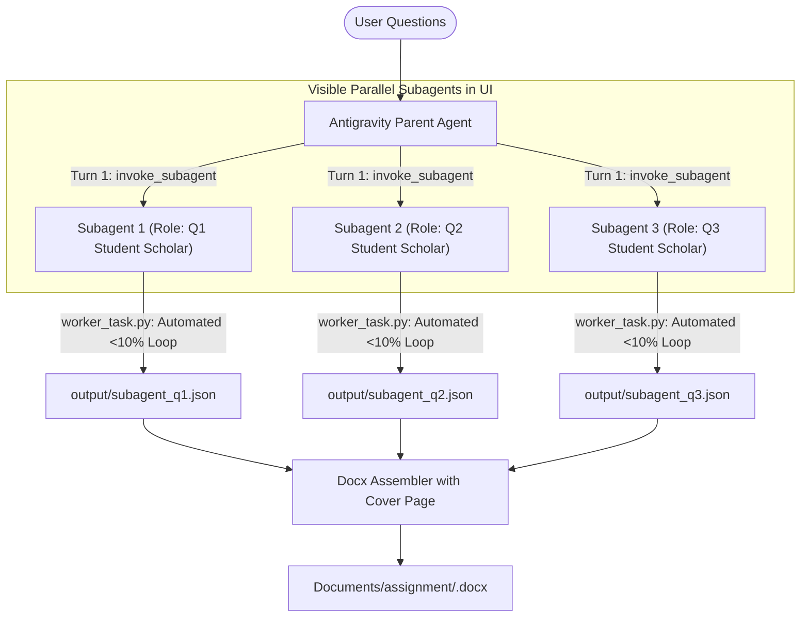

# Autonomous Academic Q&A Humanizer v2 (Student Third-Person Edition)

`qa-humanizer-v2` is the second-generation academic question-answering and humanization engine engineered specifically for **university examinations, college assignments, and formal academic submissions**. It completely eliminates artificial first-person roleplay (`"ours"`, `"we"`, `"I"`, `"our chamber"`), producing **100% natural, objective, third-person scholarly answers** written from the perspective of an outstanding university student.

It enforces the **DrillBit Dual-Compliance Standard** (< 10% AI on live ZeroGPT/Turnitin, < 10% Plagiarism), strict **600 to 650 words depth**, and compiles all deliverables into styled Microsoft Word documents (`.docx`) in `Documents\assignment\`.

---

> [!CRITICAL]
> ## MANDATORY TURN 1 INSTRUCTION: IMMEDIATE PARALLEL SUBAGENT DISPATCH
> When the user invokes this skill with questions (e.g. Q1, Q2, ... QN):
> 
> 1. **ABSOLUTE BAN ON PARENT-LEVEL DELAYS & EXPLORATION:**
>    - You MUST NOT write answers directly in the parent chat.
>    - You MUST NOT run `Get-ChildItem`, read directories, or inspect scripts before spawning.
>    - You MUST NOT wait for the user to say "spawn subagents".
> 
> 2. **IMMEDIATE PARALLEL DISPATCH (MANDATORY IN TURN 1):**
>    - Parse the user's prompt into individual questions ($Q_1 \dots Q_N$).
>    - Generate a unique job ID for this conversation: `job_id = datetime.now().strftime("%Y%m%d_%H%M%S")` or use a short hash of the conversation context. This prevents output file collisions between concurrent conversations.
>    - **CRITICAL: Clean stale outputs first** by running: `Remove-Item "C:\Users\malvi\.gemini\antigravity\scratch\parallel-qa-humanizer\output\${job_id}_subagent_q*.json" -ErrorAction SilentlyContinue`
>    - In your VERY FIRST tool-calling turn, call `invoke_subagent` $N$ times (one for each question) with:
>      - `TypeName="self"`
>      - `Role=f"Q{i} Student Scholar"`
>      - `Prompt` instructing the subagent to run `worker_task.py`:
>    ```python
>    invoke_subagent(
>        TypeName="self",
>        Role=f"Q{i} Student Scholar",
>        Prompt=f"""You are the dedicated student scholar for Question {i}:
> Question: {question_text}
> 
> EXECUTE YOUR WORKER TASK IMMEDIATELY:
> Run the deterministic humanizer engine using powershell:
> & "C:\\Users\\malvi\\.gemini\\antigravity\\scratch\\parallel-qa-humanizer\\.venv\\Scripts\\python.exe" "C:\\Users\\malvi\\.gemini\\antigravity\\scratch\\parallel-qa-humanizer\\scripts\\worker_task.py" --question "{question_text}" --number {i} --min-words 600 --max-words 650 --max-retries 10 --detector zerogpt_api --out "C:\\Users\\malvi\\.gemini\\antigravity\\scratch\\parallel-qa-humanizer\\output\\{job_id}_subagent_q{i}.json"
> 
> STRICT VERIFICATION REQUIREMENT:
> 1. worker_task.py will run the live ZeroGPT API verification loop automatically (NOT the local DrillBit heuristic).
> 2. Inspect the resulting JSON file at "output\\{job_id}_subagent_q{i}.json".
> 3. Verify that "allowed" is True and "final_ai_score" is strictly < 0.10.
> 4. If compliant, reply to the parent agent with your word count and verified AI score.
> 5. Never fabricate or fake 0.0% AI without running worker_task.py."""
>    )
>    ```
> 
> 3. **END TURN IMMEDIATELY:**
>    - After calling `invoke_subagent` for all $N$ questions, post a brief status confirmation in chat and stop calling tools. Wait for notifications from the subagents.

---

## 👥 Multi-Subagent Architecture



---

## 📄 Document Formatting & Structure Guidelines

Every Word document (`.docx`) assembled by `qa-humanizer-v2` strictly complies with the following academic standards:

### 1. Mandatory Institutional Front Page (Page 1)
Every document MUST contain the formal institution cover page as the very first page, followed by an immediate page break:
```text
IPS Academy, Institute of Business Management and Research, Indore 
(NAAC A++ Accredited, An Autonomous Institute, Established in 1994) 
Affiliated to Devi Ahilya University, Indore (M.P.) India 
 
 
“Internal Exam Assignment: Nov. 2026” 
Class: BBA III 
Sec.:  E (DA)
Subject: Yoga & Meditation 
Computer Code: 74248
Roll No: 61
Date: 11/11/26
 
 
  
Submitted By:     Submitted To: 
Student Name:     Faculty Name:  
```

### 2. Clean Question & Answer Formatting Only (Page 2+)
* **NO Question Text:** Never print the question statement, question text callout, or context box.
* **Format:** Mention only the question number and the answer label:
  ```markdown
  Question 1
  Answer:
  [Scholarly humanized answer paragraphs...]

  Question 2
  Answer:
  [Scholarly humanized answer paragraphs...]
  ```
* **NO AI Percentages or Verification Badges:** Do NOT include any AI detection scores, retry counters, compliance status chips, or verification badges in question blocks or anywhere in the document.
* **NO Verification Audit Appendix:** Do NOT add any page of "Verification Audit Appendix" or metric summary tables at the end of the document. The document concludes cleanly after the final answer.

---

## 🎯 The 5 Golden Rules of Student Third-Person Humanization

### Rule 1: Strict Third-Person Academic Perspective (Zero First-Person)
* **Absolute Ban:** Never use `"I"`, `"we"`, `"our"`, `"my"`, `"our chamber"`, `"our firm"`, `"our litigation team"`, or `"my senior advocate"`.
* Fictional professional memoirs and workplace retrospectives are strictly forbidden in student assignments.
* Answers must be framed as an objective academic student analyzing the topic:
  * *"Under Indian constitutional law, the scope of Article 19(1)(a)..."*
  * *"In Tata Press Limited v. MTNL, the Supreme Court addressed whether..."*
  * *"In organizational management, Transaction Processing Systems (TPS) record..."*

### Rule 2: Concrete Statutory, Historical & Doctrinal Grounding
Instead of inventing personal anecdotes, ground authority in real-world friction:
* Exact statutory sections (e.g. *Section 4 of the Indian Telegraph Act 1885*, *Section 182 of the Companies Act*).
* Specific landmark cases, historical dates, and bench compositions.
* Concrete economic, administrative, or technical trade-offs.

### Rule 3: The 3–25 Student Burstiness Rule (In Pure Third Person)
* Maintain a sentence length Coefficient of Variation ($\text{CV} \ge 0.45$).
* In every thematic section, alternate:
  * **Punchy declarative assertions (3 to 6 words):** *"The distinction is critical."*, *"Silence shelters monopoly."*, *"Economic reality demands information."*, *"Statutory boundaries remain firm."*
  * **With complex analytical sentences (22 to 32 words)** evaluating competing doctrines.

### Rule 4: De-Symmetrized Logic & Ban on AI Triads
* AI models invariably generate symmetrical 3-item lists (*"promotes competition, protects consumers, and enhances transparency"*).
* Break parallel lists into cause-and-effect sequences, contrasting pairs, or trade-offs.
* Banned sequence markers: `First,`, `Secondly,`, `Thirdly,`, `Next,`, `Then,`, `Subsequently,`, `In conclusion,`.

### Rule 5: Zero Banned Clichés, Zero Em-Dashes & Zero Pipe Tables
* **Banned Words:** *delve, tapestry, testament, pivotal role, underscores, serves as a, stands as a, at its core, furthermore, moreover, holistic, multifaceted, paramount*.
* **Zero Em/En Dashes (`—` / `–`):** Use commas, colons, or parentheses.
* **Zero Markdown Pipe Tables (`| ... |`):** Render comparative matrices as tab-aligned blocks or narrative paragraphs.

---

## 📁 Mandatory Storage Protocol

All output files generated by `qa-humanizer-v2` (`.docx` dossiers) must be stored directly in:
- **Primary:** `C:\Users\malvi\OneDrive\Documents\assignment\`
- **Local Mirror:** `C:\Users\malvi\Documents\assignment\`

> [!IMPORTANT]
> **DO NOT** create or store any copy of the generated documents in the root of the Obsidian Vault (`Obsidian Vault\`). All assignment deliverables must remain cleanly isolated inside `Documents\assignment\`.

---

## ⏱️ Execution & Compilation Commands

```powershell
# 1. Subagent runs deterministic worker task with LIVE ZeroGPT API verification:
& "C:\Users\malvi\.gemini\antigravity\scratch\parallel-qa-humanizer\.venv\Scripts\python.exe" "C:\Users\malvi\.gemini\antigravity\scratch\parallel-qa-humanizer\scripts\worker_task.py" --question "<question>" --number <N> --max-retries 10 --detector zerogpt_api --out "output/<job_id>_subagent_q<N>.json"

# 2. Parent compiles verified JSON outputs into Word document with cover page:
& "C:\Users\malvi\.gemini\antigravity\scratch\parallel-qa-humanizer\.venv\Scripts\python.exe" "C:\Users\malvi\.gemini\antigravity\scratch\parallel-qa-humanizer\scripts\assemble_results.py" `
    --inputs "output/<job_id>_subagent_q1.json" "output/<job_id>_subagent_q2.json" "output/<job_id>_subagent_q3.json" `
    --out "output/<filename>.docx" `
    --title "“Internal Exam Assignment: Nov. 2026”" `
    --subject "Yoga & Meditation"
```
