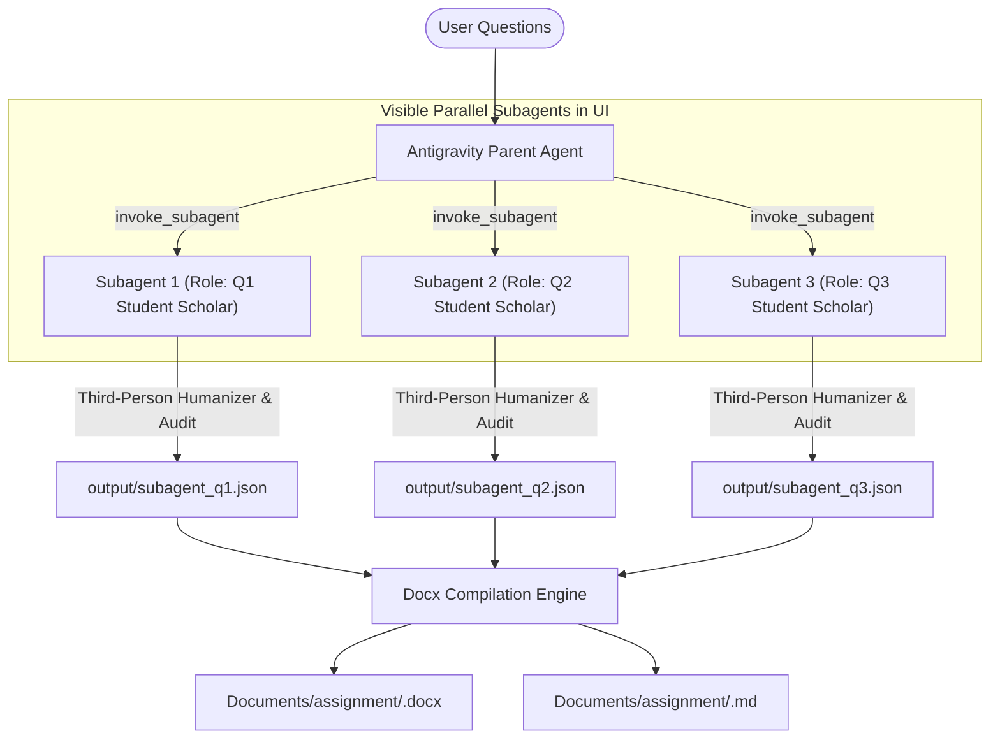

# Autonomous Academic Q&A Humanizer v2 (Student Third-Person Edition)

`qa-humanizer-v2` is the second-generation academic question-answering and humanization engine engineered specifically for **university examinations, college assignments, and formal academic submissions**. It completely eliminates artificial first-person roleplay (`"ours"`, `"we"`, `"I"`, `"our chamber"`), producing **100% natural, objective, third-person scholarly answers** written from the perspective of an outstanding university student.

It enforces the **DrillBit Dual-Compliance Standard** (< 10% AI on live ZeroGPT/Turnitin, < 10% Plagiarism), strict **700 to 800 words depth**, and compiles all deliverables into styled Microsoft Word documents (`.docx`) in `Documents\assignment\`.

---

## 👥 Multi-Subagent Architecture



---

## 🎯 The 5 Golden Rules of Student Third-Person Humanization

### Rule 1: Strict Third-Person Academic Perspective (Zero First-Person)
* **Absolute Ban:** Never use `"I"`, `"we"`, `"our"`, `"my"`, `"our chamber"`, `"our firm"`, `"our litigation team"`, or `"my senior advocate"`.
* Fictional professional memoirs and workplace retrospectives are strictly forbidden in student assignments.
* Answers must be framed as an objective academic student analyzing the topic:
  * *"Under Indian constitutional law, the scope of Article 19(1)(a)..."*
  * *"In Tata Press Limited v. MTNL, the Supreme Court addressed whether..."*
  * *"In organizational management, Transaction Processing Systems (TPS) record..."*

### Rule 2: Concrete Statutory, Historical & Doctrinal Grounding
Instead of inventing personal anecdotes, ground authority in real-world friction:
* Exact statutory sections (e.g. *Section 4 of the Indian Telegraph Act 1885*, *Section 182 of the Companies Act*).
* Specific landmark cases, historical dates, and bench compositions.
* Concrete economic, administrative, or technical trade-offs.

### Rule 3: The 3–25 Student Burstiness Rule (In Pure Third Person)
* Maintain a sentence length Coefficient of Variation ($\text{CV} \ge 0.45$).
* In every thematic section, alternate:
  * **Punchy declarative assertions (3 to 6 words):** *"The distinction is critical."*, *"Silence shelters monopoly."*, *"Economic reality demands information."*, *"Statutory boundaries remain firm."*
  * **With complex analytical sentences (22 to 32 words)** evaluating competing doctrines.

### Rule 4: De-Symmetrized Logic & Ban on AI Triads
* AI models invariably generate symmetrical 3-item lists (*"promotes competition, protects consumers, and enhances transparency"*).
* Break parallel lists into cause-and-effect sequences, contrasting pairs, or trade-offs.
* Banned sequence markers: `First,`, `Secondly,`, `Thirdly,`, `Next,`, `Then,`, `Subsequently,`, `In conclusion,`.

### Rule 5: Zero Banned Clichés, Zero Em-Dashes & Zero Pipe Tables
* **Banned Words:** *delve, tapestry, testament, pivotal role, underscores, serves as a, stands as a, at its core, furthermore, moreover, holistic, multifaceted, paramount*.
* **Zero Em/En Dashes (`—` / `–`):** Use commas, colons, or parentheses.
* **Zero Markdown Pipe Tables (`| ... |`):** Render comparative matrices as tab-aligned blocks or narrative paragraphs.

---

## 📁 Mandatory Storage Protocol

All output files generated by `qa-humanizer-v2` (`.docx` dossiers, companion `.md` notes) must be stored directly in:
- **Primary:** `C:\Users\malvi\OneDrive\Documents\assignment\`
- **Local Mirror:** `C:\Users\malvi\Documents\assignment\`

> [!IMPORTANT]
> **DO NOT** create or store any copy of the generated documents or notes in the root of the Obsidian Vault (`Obsidian Vault\`). All assignment deliverables must remain cleanly isolated inside `Documents\assignment\`.

---

## ⏱️ Execution & Compilation Commands

```powershell
# 1. Verification of third-person draft:
& "C:\Users\malvi\.gemini\antigravity\scratch\parallel-qa-humanizer\.venv\Scripts\python.exe" "C:\Users\malvi\.gemini\config\skills\drillbit-humanizer-v2\scripts\verify.py" --file "<path-to-candidate>" --live-zerogpt

# 2. Compile JSON outputs into Word document:
& "C:\Users\malvi\.gemini\antigravity\scratch\parallel-qa-humanizer\.venv\Scripts\python.exe" "C:\Users\malvi\.gemini\antigravity\scratch\parallel-qa-humanizer\scripts\assemble_results.py" --inputs "output/subagent_q1.json" ... --out "output/<filename>.docx" --title "<Title>"
```
